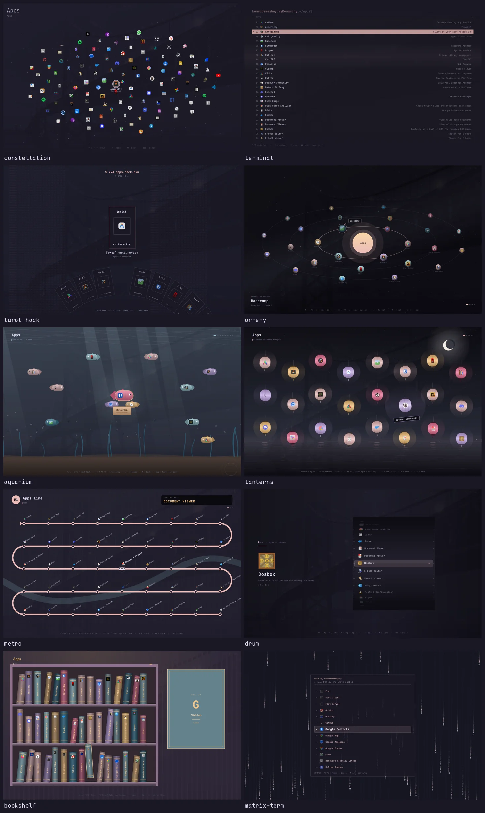
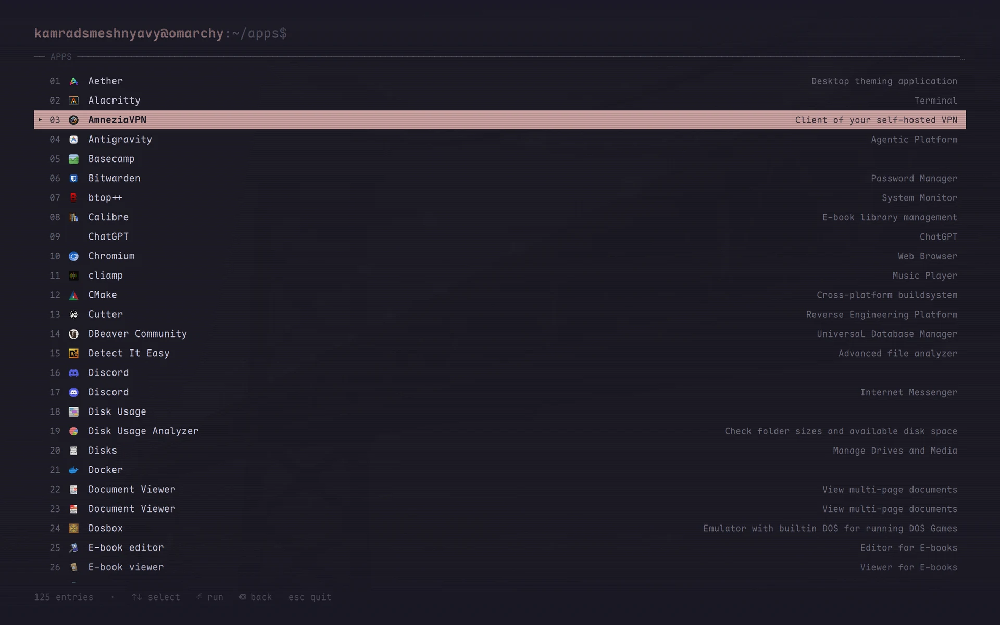

# Omarchy Launcher Skins

[🇬🇧 English](README.md)

Полноэкранные скины для меню и лаунчера приложений [Omarchy](https://omarchy.org). Клон стокового
`omarchy.menu`: все меню, поиск и действия работают как раньше — скин решает, как нарисован список. При
каждом открытии скин перекрашивается в цвета текущей темы.



| Скин | |
|---|---|
| `constellation` | приложения — звёзды на карте неба |
| `terminal` | CRT-терминал в цветах темы |
| `tarot` | веер карт; `tarot-hack` раздаёт их из `xxd apps.deck.bin` |
| `orrery` | приложения на орбитах вокруг солнца |
| `aquarium` | приложения — рыбки |
| `lanterns` | фонарики под луной |
| `metro` | схема линии метро |
| `drum` | вращающийся барабан |
| `bookshelf` | приложения — книги на полках |
| `matrix` | падающий код; `matrix-term` — в палитре терминала |
| `list` | стоковая карточка |

У всех скинов, кроме `constellation` и `terminal`, есть минималистичный терминальный двойник: `drum-hack`,
`tarot-hack`, `metro-hack`, `orrery-hack`, `matrix-hack`, `bookshelf-hack`, `lanterns-hack`, `aquarium-hack`.



## Установка

```sh
omarchy plugin add https://github.com/KamradSmeshnyavy/omarchy-launcher-skins --enable
omarchy restart shell
echo '{"skin": "orrery"}' > ~/.config/omarchy/extensions/menu-skin.json
```

Файл читается на лету — скин меняется даже при открытом меню. Открывается как обычно: Super+Space (меню),
Super+Alt+Space (приложения). Необязательный `"backdrop": 0.94` — насколько просвечивает рабочий стол.
Вернуть стоковое меню: `omarchy plugin enable omarchy.menu`.

Проверено на Omarchy 4.0.6 и Quickshell 0.3.2.

## Клавиши

Набор текста — поиск, как в стоке. Кроме того:

| Клавиши | |
|---|---|
| ↑ ↓ / Ctrl+J Ctrl+K | по списку или по кольцу |
| ← → / Ctrl+H Ctrl+L / PgUp PgDn | страницы (в обычных списках — назад / открыть) |
| Home / End | первый / последний |
| Alt+1…9 | быстрый запуск пункта с номером |
| Enter / Backspace / Esc | открыть / назад / закрыть |

## Свой скин

Скин — QML-файл, наследник `SkinBase.qml`, зарегистрированный в `SkinConfig.qml` (`files`).
`ThemePalette.qml` отдаёт ему весь `colors.toml` текущей темы. Скин с `pageSize` (и `radial: true` для
колец) получает от базы постраничность: `page`, `pages`, `pageStart`, `pageCount`, `ringStep()`,
`pageStep()` и анимированный `ringPhase`. `variant` — `"hack"` / `"term"` для двойников.

## Лицензия

MIT. Основано на `omarchy.menu` из [Omarchy](https://github.com/basecamp/omarchy) (MIT, © David Heinemeier
Hansson).

В [моих dotfiles](https://github.com/KamradSmeshnyavy/dotfiles) есть ещё скины, портированные из
[omlauch](https://github.com/hamzaabde-langjk/omlauch) и
[omarchy-quickapps](https://github.com/bjarneo/omarchy-quickapps). Сюда они не вошли: у этих проектов пока нет
лицензии.
